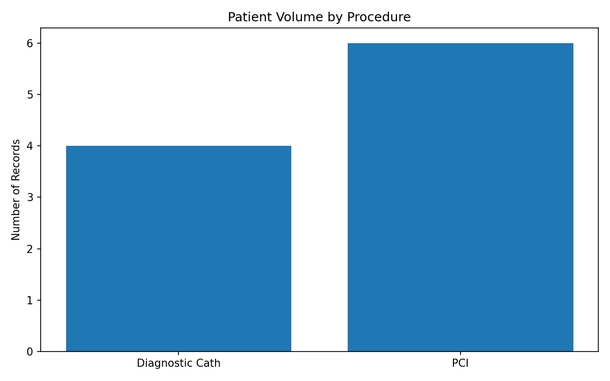
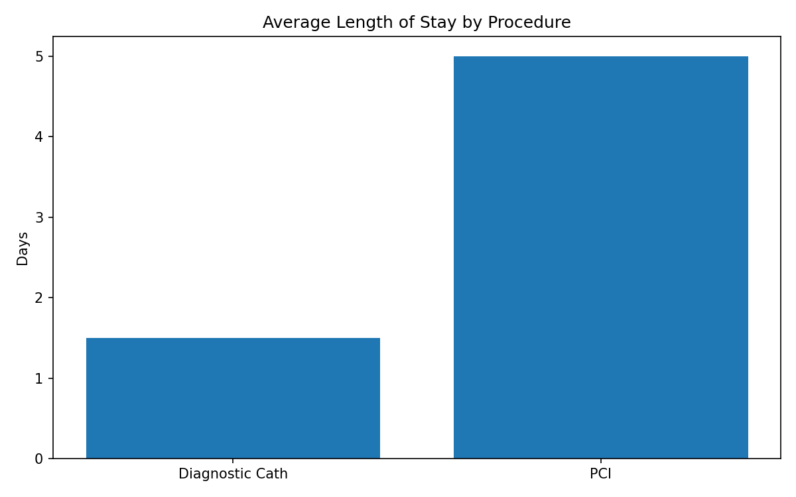
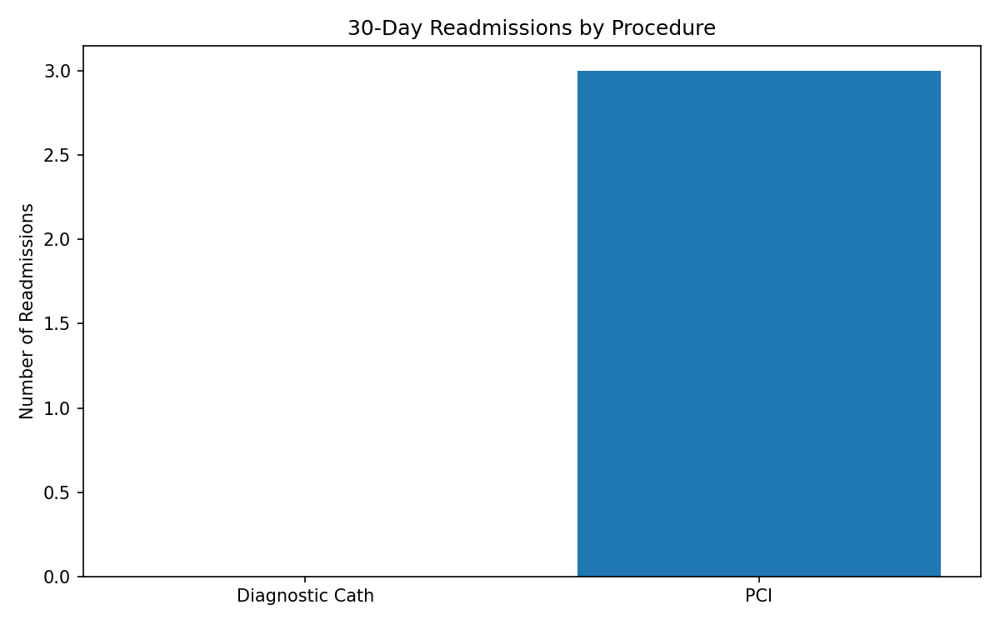

# Cardiovascular Quality & Outcomes Analysis

## Project Overview

An introductory healthcare analytics project using
synthetic cardiovascular procedure records.

The project demonstrates clinical data validation,
SQL analysis, and automated data visualization.

## Tools

- Python 3
- SQLite
- Matplotlib
- Git and GitHub

## Objectives

1. Import cardiovascular procedure data.
2. Calculate procedure-level summary metrics.
3. Identify missing or invalid clinical data.
4. Visualize patient volumes, length of stay,
   and 30-day readmissions.

## Dataset

10 fictional patient records representing PCI
and diagnostic cardiac catheterization procedures.

No real patient information is used.

## Findings

| Metric | Diagnostic Cath | PCI |
|---|---|---|
| Patient records | 4 | 6 |
| Average LOS | 1.5 days | 5.0 days |
| Readmissions | 0 | 3 |

One PCI record has a missing length-of-stay value.
Average LOS excludes missing values.

## Visualizations

### Patient Volume

### Average Length of Stay

### Readmissions

## How to Run

Install the required dependency:

    python3 -m pip install -r requirements.txt

Run the SQL analysis:

    python3 analysis.py

Generate the charts:

    python3 dashboard.py

## Limitations

This project uses a small synthetic dataset.

Results are illustrative and are not representative
of real cardiovascular patient outcomes.

The analysis is not risk-adjusted and does not
implement official NCDR or STS registry measures.

## Future Improvements

- Add more comprehensive data validation.
- Analyze a larger public healthcare dataset.
- Create additional quality metrics.
- Develop an interactive dashboard.
